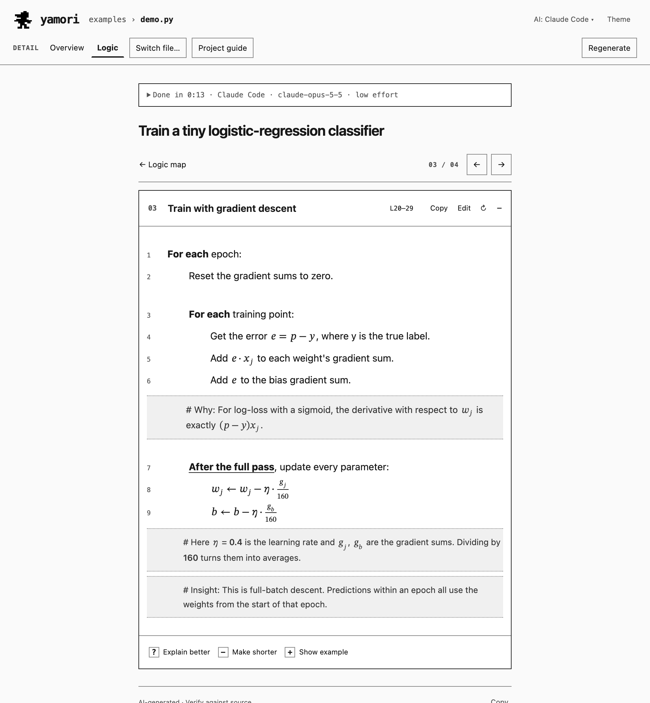
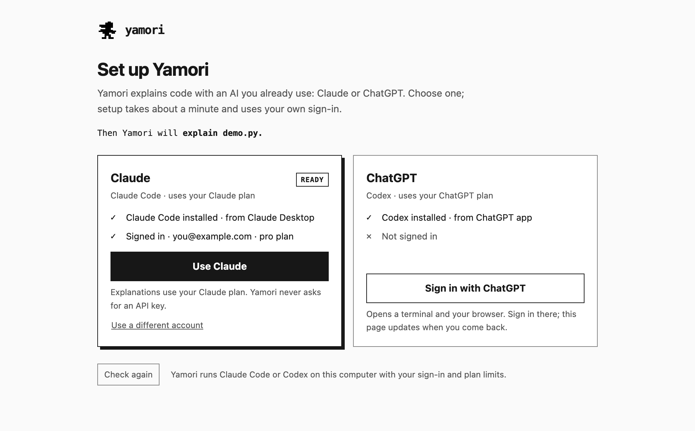

<p align="center"></p>

<h1 align="center">Yamori 🦎</h1>

<p align="center"><strong>Read any code as pseudocode, right beside it.</strong><br>
Short, numbered steps next to your editor, every line linked back to the source.</p>

<p align="center">
  
</p>

<p align="center">
  <a href="https://marketplace.visualstudio.com/items?itemName=cowana-ai.yamori">Install from the VS Code Marketplace</a>
  &nbsp;·&nbsp;
  <a href="https://open-vsx.org/extension/cowana-ai/yamori">Install from Open VSX</a><br>
  No API key: runs on your Claude Code or Codex login.<br>
  Works in VS Code and Cursor; Python, JS/TS, Go, Rust and Java.
</p>

**Quick start:** install, open a file, click the gecko (top right of the editor).
The first time, Yamori finds Claude Code or Codex on your machine (including inside
Claude Desktop or the ChatGPT app) and offers one button: Use, Sign in or Install.

- **Two depths.** *Overview* gives the goal and main stages; *Logic* gives every meaningful step, with formulas rendered as math.
- **Linked both ways.** Click a pseudocode line to jump to the code it stands for. Block titles appear above the code itself.
- **Make it yours.** Edit a block, ask it to explain better, or make it shorter. Cached reads use no AI.

**Also in Yamori**
- **Project guide:** where to start reading, folder by folder; a map of how files connect; a glossary of project terms
- **Explain how it flows:** search any name and trace it across files
- **Run with a test:** watch a function run line by line, with values (a real Python test, or a labelled simulation)
- **Chat & plan:** turn a goal into steps on the map, then let your agent implement after you approve
- **For your agents:** an MCP server so Claude Code and Codex can use the same map and pseudocode
- **Local and private:** explanations cached on your machine; works in Restricted Mode

<p align="center">
  <a href="https://marketplace.visualstudio.com/items?itemName=cowana-ai.yamori"></a>
  <a href="https://marketplace.visualstudio.com/items?itemName=cowana-ai.yamori"></a>
  <a href="https://open-vsx.org/extension/cowana-ai/yamori"></a>
  <a href="https://github.com/cowana-ai/yamori/actions/workflows/ci.yml"></a>
  <a href="https://github.com/cowana-ai/yamori/blob/HEAD/LICENSE"></a>
</p>

<p align="center">
  
</p>

## Features

### [Code as pseudocode](docs/reading.md)
Read a file at **Overview** (the goal and main stages) or **Logic** (every meaningful
step, with formulas). Each line links back to the source it stands for. You can edit
a block, ask it to explain better, or make it shorter.

### [Uses the AI you already have](docs/getting-started.md#set-up-an-ai)
Yamori runs **Claude Code** or **Codex** with your own sign-in and plan limits, and
never asks for an API key. It finds them inside **Claude Desktop** and the
**ChatGPT app**, and a one-screen setup installs or signs in whichever you pick.

### [A guide to the whole project](docs/project-guide.md)
**Start here** lists, folder by folder, which files to read first. The **Map** shows
how files connect. AI notes add a purpose to every file and a glossary of project
terms such as IDs, stages and constants.

### [Search a name, see how it flows](docs/project-guide.md)
Search any variable, function or term. Every file that mentions it lights up on the
map, and **Explain how it flows** traces it across those files in the same
pseudocode style.

<p align="center">
  
</p>

### [Watch a function run](docs/tests.md)
When a unit test calls a function, **Run with a test** shows it like a notebook
cell: **In**, **Out**, and every executed line with the values it changed. Files and
images show as emoji with details on hover. In Restricted Mode, or for JS/TS tests,
an AI simulation stands in, clearly labelled as one.

### [Your agents can share their explanations](docs/agents.md)
One command adds Yamori's knowledge server to your own Claude Code and Codex. They can
look up the project map and Yamori's pseudocode, and when they read a file to
understand it, save pseudocode for it, so you see it in Yamori without generating it.

### [Fast by design](docs/models.md#speed-parallel-parts-and-background-review)
Bigger files are written as parallel parts, so the draft is ready when the slowest
part is: **17 s instead of 50 s** on a 354-line file. Review runs in the background
on a cheaper model, and quick jobs use Haiku or Codex's fast model.

### [Knows your project](docs/project-guide.md)
Explanations use the project map: which file defines a name, what each neighbour is
for, and how other files were explained. Project terms become links and hovers, and
CodeLens shows block titles above the code.

### [Local and private](docs/reading.md)
Explanations, notes and drafts are cached on your machine; cached reads use no AI.
Yamori works in Restricted Mode, where it never runs project code and ignores
workspace-controlled settings.

## Getting started

1. Install **Yamori** from the [VS Code Marketplace](https://marketplace.visualstudio.com/items?itemName=cowana-ai.yamori),
   or from [Open VSX](https://open-vsx.org/extension/cowana-ai/yamori) for Cursor:
   ```sh
   code --install-extension cowana-ai.yamori
   ```
2. Open a code file and click the **gecko** at the top right of the editor, or
   **Yamori** in the status bar.
3. The first time, **Set up Yamori** shows which AI is on your computer, with one
   button each: **Use**, **Sign in** or **Install**. Then your file opens as pseudocode.

<p align="center">
  
</p>

Try it on [examples/demo.py](examples/demo.py), a small logistic-regression example.
Open **Project guide** to see where to start reading a whole project.

## Documentation

- [Getting started](docs/getting-started.md): installing, setting up an AI, first steps
- [Reading code](docs/reading.md): Overview and Logic, editing, caching, change tracking
- [Project guide](docs/project-guide.md): Start here, the map, AI notes, search and flows
- [Run a function with its tests](docs/tests.md): real runs, AI simulations, values as emoji
- [Models, speed and review](docs/models.md): models and effort, parallel parts, background review
- [Yamori for your own agents](docs/agents.md): Connect, `.yamori/` pseudocode, tools, agent-written pseudocode
- [Development](docs/development.md): layout, building, testing
- [Release history](HISTORY.md) · [Contributing](CONTRIBUTING.md) · [Security](SECURITY.md) · [Credits](docs/credits.md)

## License

[MIT](LICENSE). The gecko samurai mascot is separate artwork and not covered by the
code license. Bundled third-party components and their licenses are listed in
[Credits](docs/credits.md).

## Chat, plan and work in one place

Open **Chat & plan** to discuss your project, turn a goal into editable steps on the map, and ask your agent to test or implement changes. Replies stream as the agent writes, and the conversation stays after a plan finishes. The agent receives your current source tab and selected lines, including unsaved edits, when you send a message. The canvas opens by default; **< > Focus chat** expands the conversation. Highlight code in the VS Code editor to open an inline question field, then press **Ask Yamori** to send the question and selected snapshot to chat. You can also right-click → **Yamori: Ask About Selected Code**, or use **⌘⌥Q** on macOS / **Ctrl+Alt+Q** on Windows and Linux. **Continue from…** imports an existing local Codex or Claude Code session and can resume its native context. The Git badge updates locally without an AI call. Choose starting files, inspect affected code and tests, drag steps into order, and request proposed pseudocode only where needed. Context is budgeted and cached explanations are checked for freshness. Press **Approve & implement** to let the selected Codex or Claude agent apply the plan and run checks. Successful plans clear from the canvas and stay in local history; failed or stopped runs keep the plan. You can also copy the plan as an agent prompt or export Markdown. [Planning guide](docs/project-guide.md#plan-a-change).
