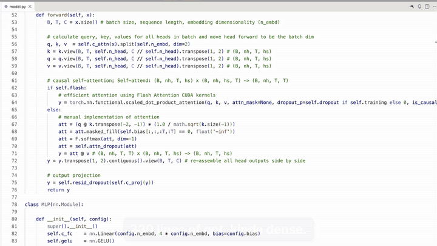
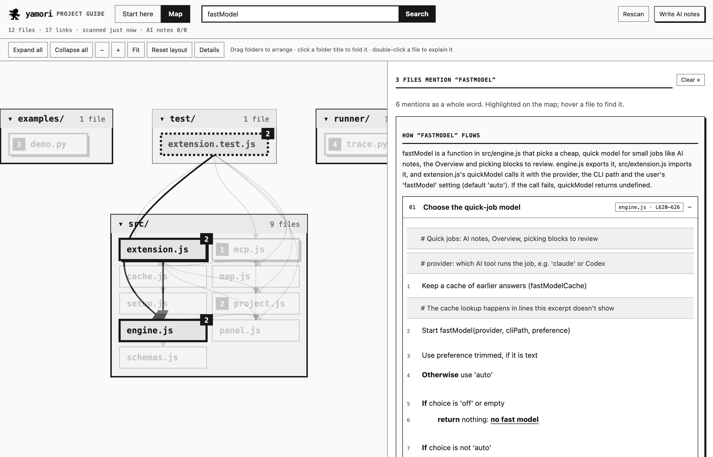

# Yamori: Work in pseudocode
Read, plan and edit code as numbered pseudocode beside the editor. Your agent updates the code.

<p align="center">
  <a href="https://open-vsx.org/extension/cowana-ai/yamori"></a>
  <a href="https://open-vsx.org/extension/cowana-ai/yamori"></a>
  <a href="https://github.com/cowana-ai/yamori/blob/main/LICENSE"></a>
  <a href="https://marketplace.visualstudio.com/items?itemName=cowana-ai.yamori"></a>
  <a href="https://marketplace.visualstudio.com/items?itemName=cowana-ai.yamori"></a>
  <a href="https://github.com/cowana-ai/yamori/actions/workflows/ci.yml"></a>
</p>

<p align="center">
  
</p>

<p align="center"></p>

<p align="center">
  <a href="https://open-vsx.org/extension/cowana-ai/yamori">Install from Open VSX</a>
  &nbsp;·&nbsp;
  <a href="https://marketplace.visualstudio.com/items?itemName=cowana-ai.yamori">Install from the VS Code Marketplace</a>
  &nbsp;·&nbsp;
  <a href="https://try-yamori.dev">try-yamori.dev</a><br>
  No API key: uses your Claude Code or Codex login.<br>
  Works in VS Code, Cursor, Kiro, and other VS Code-compatible editors.<br>
  Free, MIT license. Python, JS/TS, Go, Rust and Java.
</p>

## Why Yamori

Most of what you read in the editor now is code you didn't write: other people's repositories, and more and more, code your agent wrote. Yamori lets you work in that code as numbered pseudocode — read the logic, plan a change, edit the steps, and your agent updates the source.

## Features

### [Code as pseudocode](docs/reading.md)
Read a file at **Overview** (the goal and main stages) or **Logic** (every meaningful step, with formulas rendered as math). Click a pseudocode line to jump to the code it stands for. Block titles appear above the code itself.

<p align="center">
  
</p>

### Edit in pseudocode
Edit steps in the pseudocode beside the file, and your agent updates the code. The steps stay linked to the source, so you can follow the logic as it changes. You can also ask a block to explain better, or make it shorter, without changing the source.

### [Plan a change](docs/project-guide.md#plan-a-change)
Open **Chat & plan**, describe a goal, and Yamori drafts editable steps on the project map. Before/after pseudocode is there on demand, so you can review the intended logic before any source changes. Edit the steps, leave comments, or reject a file, then press **Approve & implement** to let your Claude Code or Codex agent apply the plan and run checks.

### [A guide to the whole project](docs/project-guide.md)
**Start here** lists, folder by folder, which files to read first. The **Map** shows how files connect. AI notes add a purpose to every file and a glossary of project terms such as IDs, stages and constants. Search any variable, function or term: every file that mentions it lights up on the map, and **Explain how it flows** traces it across those files in the same pseudocode style.

<p align="center">
  
</p>

### [Uses the AI you already have](docs/getting-started.md#set-up-an-ai)
Yamori runs **Claude Code** or **Codex** with your own sign-in and plan limits, and never asks for an API key. It finds them inside **Claude Desktop** and the **ChatGPT app**, and a one-screen setup installs or signs in whichever you pick.

### [Watch a function run](docs/tests.md)
When a unit test calls a function, **Run with a test** shows it like a notebook cell: **In**, **Out**, and every executed line with the values it changed. In Restricted Mode, or for JS/TS tests, an AI simulation stands in, clearly labelled as one.

### [Your agents can share their explanations](docs/agents.md)
One command adds Yamori's knowledge server to your own Claude Code and Codex. They can look up the project map and Yamori's pseudocode, and when they read a file to understand it, save pseudocode for it, so you see it in Yamori without generating it.

### [Fast, local and private](docs/reading.md)
Explanations, notes and drafts are cached on your machine; cached reads use no AI. Bigger files are written as parallel parts, so the draft is ready when the slowest part is. Yamori works in Restricted Mode, where it never runs project code and ignores workspace-controlled settings.

## Quick start

1. Install **Yamori** from the [VS Code Marketplace](https://marketplace.visualstudio.com/items?itemName=cowana-ai.yamori),
   or from [Open VSX](https://open-vsx.org/extension/cowana-ai/yamori) for Cursor and other compatible editors:
   ```sh
   code --install-extension cowana-ai.yamori
   ```
2. Open a code file and click the **gecko** at the top right of the editor, or **Yamori** in the status bar.
3. The first time, **Set up Yamori** shows which AI is on your computer, with one button each: **Use**, **Sign in** or **Install**. Then your file opens as pseudocode, ready to read, plan or edit.

<p align="center">
  
</p>

Try it on [examples/demo.py](examples/demo.py), a small logistic-regression example. Open **Project guide** to see where to start reading a whole project.

## Languages and editors

Yamori reads **Python**, **JavaScript**, **TypeScript**, **Go**, **Rust** and **Java**.

It works in **VS Code**, **Cursor**, **Kiro**, and other editors that support VS Code extensions, including **VSCodium**, through the [VS Code Marketplace](https://marketplace.visualstudio.com/items?itemName=cowana-ai.yamori) or [Open VSX](https://open-vsx.org/extension/cowana-ai/yamori).

## Privacy and cost

Yamori never asks for an API key. It uses the Claude Code or Codex login already on your machine, and that tool's plan limits. Explanations are cached in local extension storage, outside your project; opening a cached file uses no AI. You can clear the cache at any time with **Yamori: Clear Cached Explanations**.

In Restricted Mode, Yamori does not run project code and ignores workspace-controlled settings. Applying changes to source, or running a real unit test, needs a trusted workspace.

## FAQ

**Does Yamori need an API key?**
No. It runs on your existing Claude Code or Codex sign-in. The first time you click the gecko, it offers **Use**, **Sign in** or **Install**.

**Can I use it on code my agent just wrote?**
Yes. That is a core use: read the new file as linked pseudocode, edit the steps, and let your agent update the code.

**Does editing the pseudocode change the code?**
Yes. Edit steps in the pseudocode, and your agent updates the code. You can also ask a block to explain better, or make it shorter, which only changes the explanation.

**Where is my code sent?**
Yamori calls the Claude Code or Codex CLI already signed in on your machine, under that tool's ordinary terms. Cached explanations stay on your computer and are reused without another model call.

**Is it free?**
The extension is free and [MIT](LICENSE) licensed. Generation uses the limits of your Claude or ChatGPT plan. Cached reads cost nothing.

## Documentation

- [Getting started](docs/getting-started.md): installing, setting up an AI, first steps
- [Reading code](docs/reading.md): Overview and Logic, editing, caching, change tracking
- [Project guide](docs/project-guide.md): Start here, the map, AI notes, search, flows and [planning](docs/project-guide.md#plan-a-change)
- [Run a function with its tests](docs/tests.md): real runs, AI simulations, values as emoji
- [Models, speed and review](docs/models.md): models and effort, parallel parts, background review
- [Yamori for your own agents](docs/agents.md): Connect, `.yamori/` pseudocode, tools, agent-written pseudocode
- [Development](docs/development.md): layout, building, testing
- [Changelog](CHANGELOG.md) · [Contributing](CONTRIBUTING.md) · [Security](SECURITY.md) · [Credits](docs/credits.md)

## Contributing

Bug reports, ideas and pull requests are welcome. See [Contributing](CONTRIBUTING.md) for how to run the tests and open a PR.

## License

[MIT](LICENSE). The gecko samurai mascot is separate artwork and not covered by the code license. Bundled third-party components and their licenses are listed in [Credits](docs/credits.md).
